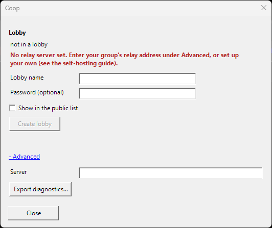
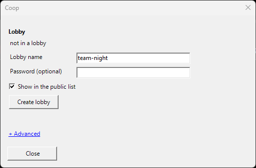
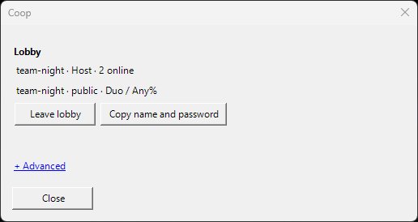
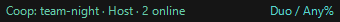
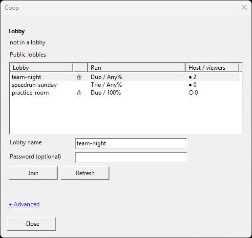

# Quick start / Schnellstart

## English

1. Install LiveSplit separately (tested: 1.8.34 on Windows 10/11, .NET Framework 4.8). Back up your splits/layout and try it in a separate LiveSplit copy first.
2. Download the component ZIP from this repository's Releases and copy `Components/LiveSplit.Coop.dll` into LiveSplit's `Components` directory. Restart LiveSplit. The archive does not include LiveSplit itself.
3. In LiveSplit, right-click **Edit Layout**, add **Control → Coop Relay**, open its settings and choose the **Role** of this layout: **Host** (this timer measures) or **Viewer** (follow the host). The role belongs to the layout, so the host and the teammates each use their own layout. Close the settings; you do not need to save anything else for coop.
4. Right-click the timer and choose **Coop...**. This one entry opens the coop window.

### Set the relay (everyone, once)

There is no built-in server. Right-click → **Coop...** → **Advanced** → **Server**: enter your group's relay address (`wss://…/coop`). Everyone in the group uses the same one. Until an address is entered, the window says so and Create/Join stay disabled. No relay yet? Set one up on Cloudflare's free plan in about 10 minutes: [Run your own relay](self-hosting-cloudflare.md). A game package can also preset the server (see profile packs below).

### Host

1. Load your own splits and autosplitter. In a coop game this should be the person hosting the game lobby.
2. In the coop window enter a **lobby name** (3-32 characters: `a-z`, `0-9`, `-`, `_`; uppercase is lowercased), an optional **password**, and decide whether to **show in the public list**. Click **Create lobby**.
3. The name and password are copied to the clipboard for your teammates. Send them privately. **Copy name and password** copies them again. Never post a password you want to keep private.
4. After **Leave lobby**, **Reopen lobby <name>** brings the same lobby back. The status line in the layout reads `<lobby> · Host · N online`.

### Viewers

1. Use a separate layout with role **Viewer**, without a Scriptable Auto Splitter component, and deactivate the registered autosplitter in Edit Splits. Disable local timer-control hotkeys and reset any local attempt before joining.
2. In the coop window pick a lobby from the **public list** (**Refresh** reloads it) or type the name the host sent you. Enter the password, if there is one, and click **Join**.
3. Possible messages: *Wrong password*, *Lobby not found or expired*, *Too many failed attempts. Wait a minute.* (10 wrong passwords within a minute lock your address out of that lobby for the rest of the minute).
4. The status line reads `<lobby> · following host`. Viewers do not select Duo/Trio or match the host's split file; the visible layout stays their own while the host supplies run and timing data.

_Screenshots were generated with example data by `scripts/render-doc-screenshots.ps1`._

### During the run

Start the run on the host. Start, completed splits, pause, undo, reset and finish propagate. Ended times stay visible until the host resets or the viewer leaves. Running digits can lag by network delay; completed split and final times copy the host's exact values. A second client using the lobby's host credentials takes over the host slot and stops the previous host connection.

### Remembered lobby and reconnecting

The current lobby is saved in `coop-local.json` next to `LiveSplit.exe`; the keys in it are encrypted with Windows DPAPI for this Windows account and machine. LiveSplit reconnects automatically on start, and the component retries after network loss or a temporarily full lobby. **Save Layout** is no longer needed for coop. Rooms that older versions stored in layouts are moved to `coop-local.json` once. Layouts no longer contain keys. On another PC, join the lobby again with name and password. Do not publish `coop-local.json`.

### Viewers keep their splits

While a viewer follows the host, attempts they watch are recorded into the viewer's own splits file: a matching profile from a `coop-profiles.json` pack if there is one, otherwise `Splits/Coop/<game>/<category>.lss` next to LiveSplit. If the host's PB is faster, it is taken over on first contact. A viewer's attempt is recorded only when it was followed while connected. If a host timer on the same PC has that file open, the attempt goes to `Splits/Coop/Pending/` instead and the coop window says so.

### Advanced

Open **Advanced** in the coop window:

- **Server**: the relay address (`wss://…/coop`). It comes from the game package's `coop-profiles.json` (`server`) if there is one; what you enter here overrides it. A group can run its own relay for free on Cloudflare: [Run your own relay](self-hosting-cloudflare.md), or follow [deployment](deployment.md) for Linux. Everyone in the group needs the same server address. The relay can technically see timer data (splits, PBs, game, category).
- **Join with invitation** (viewers): paste an older `lscoop:1:` invitation code.
- **Export diagnostics...**: see [diagnostics](diagnostics.md).

### Profile packs (for game package authors)

A game package can ship a `coop-profiles.json` next to its files that maps a game/category selection to splits and layout, and can preset the relay with an optional `server` field. The host shows the matching profile label in public lists, and viewers record into the matching splits. Format: [lobbies design, section 3.3](superpowers/specs/2026-10-12-lobbies-design.md).

### Invitation codes (older versions)

Versions before the lobby flow used `lscoop:1:...` invitation codes for rooms. They still work: viewers paste them under **Advanced → Join with invitation**. The code contains only the viewer key; never share a host key. Lobbies need a relay that supports them (the Cloudflare relay from the guide does); other relays answer with *This server has no lobbies*, and invitations are then the way in.

Keys are stored only on the player's PC. No VPN or router port-forwarding is required on player PCs. The relay operator exposes only the chosen TLS endpoint.

## Deutsch

Die vollständige deutsche Anleitung steht in [setup.de.md](setup.de.md). Kurzfassung: LiveSplit separat installieren, `Components/LiveSplit.Coop.dll` nach `Components` kopieren, im Layout **Control → Coop Relay** hinzufügen und die Rolle (Host oder Viewer) wählen, dann per Rechtsklick **Coop...** öffnen und unter **Erweitert → Server** die Relay-Adresse eurer Gruppe eintragen (`wss://…/coop`). Der Host legt eine Lobby an (Name, optional Passwort) und schickt Name und Passwort an die Mitspieler; Mitspieler wählen die Lobby aus der Liste oder tippen den Namen und treten bei.
