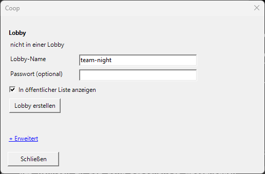
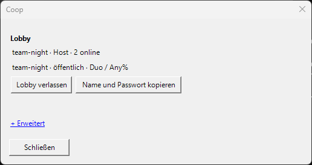
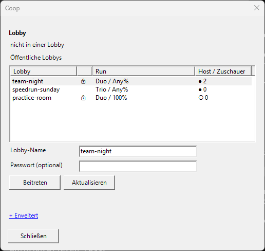

# Einrichtung und Arbeitsstand

LiveSplit Coop ist ein selbst hostbarer Coop-Timer. Der Spielhost misst; alle Mitspieler sehen seine Werte in ihren eigenen LiveSplit-Fenstern. Auf den Spiel-PCs ist nur eine zusätzliche LiveSplit-DLL nötig. Kein VPN, kein separates Begleitprogramm.

## Einrichtung

1. DLL mit `scripts/build.ps1` bauen (siehe README) oder die fertige `LiveSplit.Coop.dll` aus dem Release-ZIP nehmen.
2. Zuerst eine eigene Testkopie von LiveSplit anlegen. Original-Splits und Original-Layouts nicht überschreiben.
3. `LiveSplit.Coop.dll` nach `Components` der Testkopie kopieren; LiveSplit neu starten.
4. Im Layout **Control → Coop Relay** hinzufügen, die Einstellungen öffnen und die **Rolle** wählen: **Host** (dieser Timer misst) oder **Viewer** (dem Host folgen). Die Rolle gehört zum Layout; Host und Mitspieler nutzen also je ein eigenes Layout.
5. Rechtsklick auf den Timer → **Coop...** öffnet das Coop-Fenster. Mehr Menüeinträge gibt es nicht.

### Host

- Autosplitter und Splits wie gewohnt laden. Im Coop-Spiel ist das die Person, die die Spiel-Lobby hostet.
- Im Coop-Fenster einen **Lobby-Namen** eingeben (3–32 Zeichen: `a-z`, `0-9`, `-`, `_`), optional ein **Passwort** setzen und wählen, ob die Lobby in der **öffentlichen Liste** erscheint. Dann **Lobby erstellen**.
- Name und Passwort werden für die Mitspieler in die Zwischenablage kopiert und sollten privat weitergegeben werden. **Name und Passwort kopieren** kopiert sie erneut.
- Nach **Lobby verlassen** öffnet **Lobby <Name> wieder öffnen** dieselbe Lobby erneut.
- Die Statuszeile im Layout lautet `<Lobby> · Host · N online`.

### Viewer

- Eigenes Layout mit Rolle **Viewer**, ohne Scriptable Auto Splitter. Den registrierten Autosplitter außerdem deaktivieren, lokale Timer-Hotkeys abschalten und einen laufenden lokalen Versuch zurücksetzen. Sonst wird der Beitritt abgelehnt.
- Im Coop-Fenster eine Lobby aus der **öffentlichen Liste** wählen (**Aktualisieren** lädt neu) oder den Namen eintippen, Passwort eingeben und **Beitreten**.
- Mögliche Meldungen: „Passwort falsch“, „Lobby nicht gefunden oder abgelaufen“ und „Zu viele Fehlversuche. Eine Minute warten.“ (10 falsche Passwörter innerhalb einer Minute sperren eure Adresse für den Rest der Minute in dieser Lobby).
- Die Statuszeile lautet `<Lobby> · folgt Host`.

_Die Screenshots wurden mit Beispieldaten von `scripts/render-doc-screenshots.ps1` erzeugt._

### Gemerkte Lobby

Die aktuelle Lobby steht in `coop-local.json` neben `LiveSplit.exe`; die Schlüssel darin sind mit Windows-DPAPI für dieses Windows-Konto auf diesem PC verschlüsselt. Beim Start verbindet sich LiveSplit automatisch neu. **Layout speichern** ist für Coop nicht mehr nötig. Räume, die ältere Versionen im Layout gespeichert haben, werden einmalig nach `coop-local.json` übernommen. Auf einem anderen PC tretet ihr mit Name und Passwort neu bei. `coop-local.json` nicht weitergeben.

### Erweitert

Im Coop-Fenster unter **Erweitert**:

- **Server**: voreingestellt ist der Community-Relay (geschlossene Beta ohne Verfügbarkeitsgarantie). Ihr könnt auch einen eigenen Relay betreiben, kostenlos auf Cloudflare: [Eigenen Relay betreiben](self-hosting-cloudflare.de.md). Alle in der Gruppe brauchen dieselbe Serveradresse.
- **Mit Einladungscode beitreten** (Viewer): einen älteren `lscoop:1:`-Code einfügen.
- **Diagnose exportieren...**: siehe [Diagnose](diagnostics.md).

### Einladungscodes (ältere Versionen)

Vor den Lobbys wurden Räume über `lscoop:1:...`-Einladungscodes geteilt. Sie funktionieren weiter: Viewer fügen sie unter **Erweitert → Mit Einladungscode beitreten** ein. Der Code enthält nur den Viewer-Schlüssel; den Host-Schlüssel nie weitergeben. Auf Relays ohne Lobby-Unterstützung sind Einladungen der einzige Weg.

### Profil-Pakete

Spiel-Pakete können eine `coop-profiles.json` mitliefern, die eine Spiel-/Kategorie-Auswahl auf Splits und Layout abbildet. Das Format steht im [Lobby-Entwurf, Abschnitt 3.3](superpowers/specs/2026-10-12-lobbies-design.md).

Für einen lokalen Test nutzt ihr als Server `ws://127.0.0.1:8787/coop` auf demselben PC. Bei verschiedenen PCs wird ein per HTTPS/WSS erreichbarer Relay benötigt, etwa `wss://timer.example.com/coop`. Ein localhost-Link ist nicht die Adresse für eure Mitspieler.

## Verhalten

- Der Host behält seine Messmethode, seinen Autosplitter und seine maßgebliche Splitdatei.
- Mitspieler erhalten auch vergangene Checkpoints, PBs und Bestsegmente. Real Time bleibt Real Time; leere Game-Time-Werte werden nicht erfunden.
- Der Viewer arbeitet mit einer temporären Run-Kopie ohne Dateipfad. Beim Verlassen der Lobby werden die zuvor geladenen lokalen Splits wiederhergestellt.
- Viewer behalten ihre Splits: Versuche, die sie mitverfolgen, werden in die eigene Splitdatei geschrieben (passendes Profil aus einer `coop-profiles.json`, sonst `Splits/Coop/<Spiel>/<Kategorie>.lss` neben LiveSplit). Ist die PB des Hosts schneller, wird sie beim ersten Kontakt übernommen.
- Die Endzeit wird exakt vom Host übernommen. Die laufende Anzeige kann durch die Übertragung etwas nachlaufen.
- Bei Verbindungsabbruch erscheint **OFFLINE — timer frozen**. Spätestens nach 1,5 Sekunden ohne frischen Snapshot wird angehalten. Nach Wiederverbindung folgt der Viewer dem vollständigen aktuellen Zustand.
- Nach Ende bleibt das Ergebnis sichtbar, solange ihr verbunden seid und der Host den Run nicht zurücksetzt. Die maßgebliche Splitdatei ist die des Hosts; die der Viewer ergänzt sich wie oben beschrieben.

## Schlüssel

Der Host-Schlüssel gehört nur dem Spielhost; das Lobby-Passwort ist für die Mitspieler. Layouts enthalten keine Schlüssel. Die Lobby steht in `coop-local.json`, die Schlüssel darin sind für dieses Windows-Konto auf diesem PC verschlüsselt. Ein vorbereitetes portables Paket erledigt die Einrichtung über `Start-Coop.cmd` aus seiner privaten Zugangsdatei; solche Pakete nur innerhalb der eigenen Gruppe weitergeben.

## Noch ausstehend

Die automatisierten lokalen Tests und ein Test mit drei echten LiveSplit-Fenstern und Dashboard-Kopien sind durchgeführt. Start, Splits, Pause, Wiederverbindung, Zieleinlauf und Reset wurden mit Beispieldaten geprüft. Die Originaldateien blieben unverändert.

Am 27.09.2026 wurde nach Freigabe ein separater Relay auf einem Linux-VPS mit rootless Docker und direktem TLS auf Port 8443 eingerichtet. Die vorhandenen Webapps auf 80/443 blieben unverändert. 24 native Prüfungen mit einem Host und zwei Viewern bestanden auch über den öffentlichen WSS-Endpunkt; zusätzliche Prüfungen bestätigen die Zugriffsgrenzen. Zertifikatsaustausch ohne Verbindungsabbruch wurde lokal getestet, der unabhängige Kopierdienst auf dem VPS erfolgreich ausgeführt.

Ein vollständiger Duo-/Trio-Spielrun einschließlich echtem Auto-Ende steht weiterhin aus. Die sichtbaren Drei-Fenster-Prüfungen liefen lokal; deren zusätzliche WAN-Variante konnte bei gesperrtem Desktop nicht starten. Der erfolgreiche native WAN-Test verwendet dieselbe Coop-DLL und das echte LiveSplit-Timermodell.
